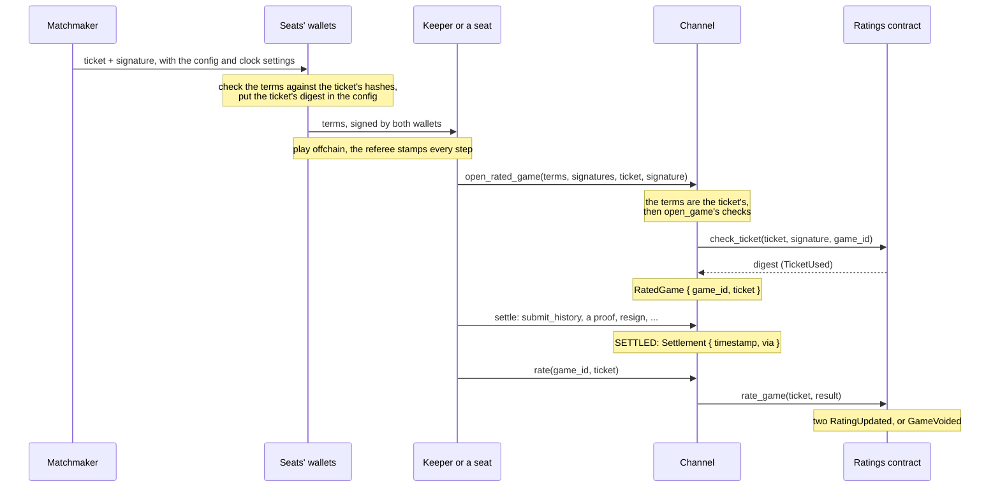

# Ratings

Arbiter can rate 2-seat games onchain. A game that wants ranked play implements `RatingRules` and deploys its own ratings contract, built from `RatingsComponent`. Its matchmaker signs a pairing ticket for each rated game, its channel opens the game on that ticket, and anyone reports the settled result for rating. This page covers the rating model, tickets, what the ratings contract checks, and who is trusted with what. To add rated play to a game, see [Add rated play](/guide/ratings).

Ratings are optional. A game without rated play only writes one line for them, `impl Unrated of RatedConfig<Config> {}`. Surround, a Go game, is the first game that uses them.

## The pieces

| Piece | Where | What it does |
| --- | --- | --- |
| `RatingRules` | The game's Cairo, compiled into its ratings contract | Pools, starting ratings, how fast uncertainty grows while a player is idle, and the rank shown |
| The ratings contract | A plain Starknet contract that embeds `RatingsComponent` | Players, tickets, policy, anchors and admin. It is not a Dojo contract, so it outlives Dojo worlds: each world's channel is an allowlisted client |
| The matchmaker | The game's own service, offchain | Pairs players and signs a `Ticket` with its key |
| The ticket's digest in the config | `arbiter::RatedConfig` | Makes rated or not part of the terms both wallets sign |
| The channel | The game's Dojo system | `open_rated_game` opens a game on its ticket and has the ratings contract accept it (`check_ticket`). `rate` reports the settled game (`rate_game`) |
| The referee | The game's referee key | Rated games are timed: the referee's first stamp dates the game, and its flag decides a timeout |
| `Settlement` and `RatedGame` | `arbiter_dojo` models | When and how a game settled, and a rated game's ticket digest |

## A rated game

A game opens onchain only when it first needs the chain, so `open_rated_game` usually goes in the same transaction as the settlement, as `open_game` does. Anyone may send `rate`.

## The model

The engine ([`ratings/src/math.cairo`](https://github.com/broody/arbiter/blob/main/ratings/src/math.cairo)) is Glicko-2's update, one game at a time, without the volatility step.

- Each player in a pool has a rating μ, a deviation φ and the time it last played. μ and φ are logits on Glicko-2's μ scale, in Q32.32 fixed point (x / 2^32).
- Each side moves by φ'²·g·(s − E): s is its score, E its expected score against the opponent's μ, and g discounts the opponent's deviation. φ' after a game is at most the deviation the side brought to it, and at least the pool's `min_phi`.
- μ stays within the pool's `mu_min` and `mu_max`.
- Instead of a volatility, φ grows while a player is idle (see Aging).
- Arithmetic is integer only. Every division rounds half to even: truncation would bias ratings downward over millions of updates. Overflow panics rather than wraps.

`@arbiter/sdk/ratings` computes the same update bit for bit, and the Cairo tests check it against vectors the SDK writes.

### Aging

A player brings a variance to each game:

- φ0², the pool's starting deviation squared, for a player never rated;
- otherwise min(φ0², φ² + c²·idle days), with c from the rules' `drift(pool, μ)`.

The opponent's deviation is aged the same way. Idle time stops adding after 2^30 seconds, long after any φ0 cap. `drift_of(half_life)` gives c for a half-life in days, KGS's drift. Surround's drift depends on rank; the test rules' is flat in each pool, with a different half-life per pool.

A game's time is its `played_at`, the referee's first stamp. A player's last-played time never moves back, so a game rated late doesn't rewind anyone's clock.

### Pools

Ratings are keyed by `(pool, player)`. A pool is a short string: Surround has one, `'go'`, for every board size, and the rated counter example has `'blitz'` and `'rapid'`. Each pool has its own constants (`Pool`), records, peaks, anchors, starting bands, rank offset, and allowed configs and clock presets. A game in one pool leaves a player's rating in the others alone.

`RatingRules::pool(id)` returns a pool's constants, or `None` for a pool the game doesn't have. See [`Pool`](/reference/ratings#pool) for each field.

### New players

A player never rated in a pool has φ 0. Its first rated game there starts it at `start(pool, band)`, with φ0. The ticket names each seat's band, 1 to 7, and the owner allows a set of bands per pool, none until set. The band matters only for that first game; a rated player's ticket still names a band the rules have.

### Provisional, established, settled and peak

| Flag | Set when | Used for |
| --- | --- | --- |
| `provisional` | φ aged to now is above `provisional_phi`, or the player has no win or no loss yet | The rank shows "?". |
| `established` | The first game after which the rank is no longer provisional. Never cleared. | A peak is recorded only for an established player. |
| `settled` | At least `settled_games` games, and φ aged to now at most `provisional_phi` | Only queue games (`source` `QUEUE`) between two settled players move a peak. |
| `peak` | The highest μ − 2φ after such a game | A conservative best rating. |

`provisional` and `settled` age φ to the time they are read, so a player who stops playing can become provisional again. `established` stays set.

### The rank shown

`RatingRules::shown(pool, μ, offset)` turns μ into the number a player sees. `elo(mu, offset)` gives the Elo-scale rating, 1500 + 173.7178·μ, the number a chess player expects. Surround shows rank tenths instead (0 is 30k, 300 is 1d). The owner sets an offset per pool, bounded by the pool's `max_offset`, which the views and events add. A player never rated shows 0.

### The packed state

Each player in a pool is one felt: μ and the peak biased in 40 bits each, φ in 34, the last-played time in 40, the band in 3, two flags, the rules' version (`params`) in 8, and wins, losses and draws in 24 bits each. So:

- μ, peaks (μ − 2φ) and anchors' pins stay within ±2^39 in Q32.32, about ±128 logits;
- deviations, φ0 included, stay below 2^34, that is below 4.

`valid_pool` checks a pool's constants against these bounds. The ratings contract refuses a ticket in a pool that fails it, and voids its games, so no pool can panic while packing. See [Packed player state](/reference/ratings#packed-player-state).

## Tickets

A `Ticket` is the matchmaker's signed pairing: the chain, the channel, both seats in the terms' order, the pool, the game's terms as hashes, the source (`QUEUE` or `TABLE`), each seat's starting band, the matchmaker's key, when it was issued and the deadline for the game's start, and a nonce.

- **Its digest** is arbiter's `signing_hash` over `'ARBITER_PAIRING_V1'`, the rules' `TAG`, the ratings contract's address and the ticket's fields. The tag keeps a ticket from being used for another game, and the address on another deployment of the same game.
- **It lives at most 15 minutes** (`MAX_TICKET_LIFE`, 900 seconds), from `issued_at` to `expires_at`. The game must start in that window, as its referee's first stamp attests.
- **It is used once.** The ratings contract accepts each digest for one game.
- **It carries the terms as hashes:** `config` is the config hash (`arbiter::config_hash`), and `referee` and `clock` are the referee key and the Poseidon hash of the clock settings. A referee's randomness tip isn't known at pairing, so the ticket can't carry the time control itself. The matchmaker sends the config and the settings with the ticket, and each client checks them against these hashes before its wallet signs.

### Rated or not is in the signed terms

A rated game's config carries its ticket's digest (`RatedConfig::ticket`), 0 for an unrated game. Both wallets sign the terms, so their signatures are their consent to the rating. Otherwise a seat losing a rated game could open the same signed terms as an unrated game, and the ticket would never be used.

- **Every game implements `RatedConfig`.** A game without rated play writes `impl Unrated of RatedConfig<Config> {}`: its configs carry no ticket. `arbiter_dojo`'s `open_game` and `open_game_delegable` refuse a config with a nonzero ticket (`'Rated game needs its ticket'`), so rated terms open only through `open_rated_game`, in every game.
- **Unrated terms can't be rated:** their config doesn't carry the ticket's digest, and `open_rated_game` requires it.
- **The config hash leaves the ticket out.** A ticket can't carry the hash of a config that holds its own digest, so `config_hash` hashes the config with its ticket set to 0: Poseidon over the game's `GameRules::TAG`, `'ARBITER_CONFIG_V1'` and the config's Serde encoding. Serde covers every field, so a game can't leave one out.
- **`with_ticket` may change only the ticket.** `is_rated_config` checks the round trip `config.with_ticket(0).with_ticket(digest) == config`, which catches a `with_ticket` that changes more.

## Opening a rated game

`arbiter_dojo::rated::open_rated_game` checks that the terms are the ticket's:

- the config carries the ticket's digest and passes the round trip, and its hash is the ticket's `config`;
- the players are `[player_0, player_1]`;
- the game is timed, with the ticket's referee and the hash of its clock settings;
- randomness: with `RatingRules::REFEREE_RNG` the clock's `rng_tip` is nonzero, so a rated game with dice can't use seat-revealed randomness; without it, `rng_tip` is 0;
- the prover and the response window are the ticket's.

It then opens the game as `open_game` does, has the ratings contract accept the ticket (`check_ticket`), and records the digest in `RatedGame`. A panic anywhere reverts the whole call, so a game opens rated or not at all. See [Rated games](/reference/dojo#rated-games) for the messages.

## What the ratings contract checks

### Accepting a ticket

`check_ticket` takes a call only from a channel the owner made active, for a ticket that names that channel and this chain. It then checks the ticket against the pool's policy:

- two distinct, nonzero seats, at most one of them an anchor;
- a lifetime of at most `MAX_TICKET_LIFE`, and a known source;
- a pool the rules have, that passes `valid_pool`;
- each seat's band: 0 for an anchor, otherwise one the rules have, and, for a player never rated in the pool, one the pool allows;
- a config hash and a clock preset the pool allows, an active referee key, an allowed prover, and a response window in the allowed range;
- an active matchmaker key, a digest never accepted, and the matchmaker's signature over it.

It doesn't check the time. A game opens when it first needs the chain, often at settlement, long after its ticket expired, so rating checks the game's start against the ticket's window instead.

### Rating a game

`rate_game` rates an accepted ticket's game once, and only for the ticket's channel, which reports the `GameResult`. A call from another caller, for another game, or for a ticket that isn't accepted changes nothing and returns `None`. A channel the owner retired still rates the games it has.

The game is then rated or voided. It is voided (`GameVoided`) when:

| Reason | When |
| --- | --- |
| `VOID_INVALID` | Its data is impossible: it never started, it started outside the ticket's window, it settled in the future or before it started, its reason isn't a finish reason a rated game can end with, or its winner isn't a seat or a draw. Also when an upgrade dropped its pool, changed the pool so that it fails `valid_pool`, or dropped a new player's band since the ticket was accepted. |
| `VOID_MATCHMAKER` | Its matchmaker was revoked from a time at or before the game started. |
| `VOID_REFEREE` | Its referee was revoked from a time at or before the game started, or the game ended by that referee's flag and settled at or after the revocation. |
| `VOID_ANCHOR` | Both seats are anchors, or a seat is neither an anchor, nor rated, nor has a band: its anchor was removed after the ticket. |
| `VOID_SHORT` | It is shorter than the pool's `min_steps`, unless it was an onchain forfeit with a winner. |

Times are checked with up to 60 seconds (`MAX_CLOCK_SKEW`) of skew between the referee's clock, the matchmaker's and the chain's. Voiding a game whose pool or band an upgrade changed means no ticket stays accepted forever.

Otherwise both sides are updated together, and each side's `RatingUpdated` event carries its state before and after. A side the game doesn't count for is aged to the game's time, or left alone if never rated. An anchor never changes. `rate_game` doesn't check the config, clock, prover or window again: `check_ticket` did when the game opened.

### The game's time and length

`arbiter_dojo::rated::rated_result` builds the `GameResult` from the channel alone:

- `played_at` is the game's `started`, its referee's first stamp. A game that settled by an onchain resignation or timeout claim before any stamp reached the chain is dated by its ticket's `issued_at`, so a losing seat can't void its loss by opening the game and resigning first;
- `settled_at` and the route come from the `Settlement` model, which the binding writes in the call that settles any game;
- `steps` is the larger of the anchor's and the candidate's `seq`.

An onchain resignation or abandonment (`VIA_RESIGN`, `VIA_TIMEOUT_CLAIM`) may settle on a stale anchor, so its step count can be short of the game's. Such a short forfeit isn't void: it counts only for the loser, and the winner's rating doesn't move.

## Anchors

An anchor is a fixed-strength player, such as an AI, pinned at a μ in a pool by the owner. It plays at its pin and the pool's `anchor_phi`, never ages, and is never stored as a player. Its games rate only its opponent, so it holds a pool's scale in place.

- The owner pins it with `set_anchor`, within the pool's `anchor_mu_min` and `anchor_mu_max`, and only if it was never rated in the pool: a rated player's games already moved others.
- Its ticket gives it band 0. Two anchors never play a rated game.
- Removing an anchor (`remove_anchor`) voids its accepted games that aren't rated yet.
- Its rank is never "?" and it is never settled, so its games move no peak.
- An anchor in one pool is an ordinary player in another.

`verifyRatings` in the SDK reports how each anchor scores against established players, the signal for re-pinning it.

## Rules in code, policy in storage

| In code: `RatingRules` | In storage: the owner's policy |
| --- | --- |
| `TAG`, `VERSION`, `REFEREE_RNG` | Channels: active, retiring or removed |
| Each pool and its constants | Matchmaker and referee keys: active, retired, or revoked from a time |
| Starting μ per band | Per pool: allowed clock presets and config hashes, allowed starting bands, the rank offset, anchors |
| `drift` and `shown` | Allowed provers and the range of response windows |
| | The owner, the timelock and `seal` |

No rule is read from storage, so rating costs no reads for settings, and the contract's code is the whole rating model. Changing a rule means deploying a new class and calling `upgrade`. Each player stores the `VERSION` that last updated it (`params`), and each `RatingUpdated` event carries it, so a replay uses the right rules for every game.

Policy changes go through the owner:

- **Before `seal`,** every change applies at once: the setup phase.
- **After `seal`,** a change that loosens policy or trusts more waits: the owner queues its hash (`admin_op`), and may apply it from 48 hours (`TIMELOCK_SECONDS`) to 7 days (`QUEUE_LIFE`) after queuing. Allowing a channel, key, preset, config, prover or band, widening the response window, setting an offset or an anchor, transferring ownership and `upgrade` all wait.
- **Tightening applies at once:** retiring or revoking a key, retiring or removing a channel, forbidding a preset, config or prover, narrowing the window or the bands, and removing an anchor.

A rules change is an `upgrade`, so it waits like the loosest policy change. The `Queued` event shows it to everyone for 48 hours before it can apply.

## Trust model

| Party | Trusted with | Bounded by |
| --- | --- | --- |
| The owner | Policy and the rules (`upgrade`) | After `seal`, loosening changes and upgrades are public for 48 hours first. Ownership moves in two steps. |
| The matchmaker key | Who plays whom, in which pool, from which band, and whether a game is a queue game | `check_ticket` holds every ticket to the pool's policy, once. The owner can retire the key, so it names no new tickets, or revoke it from a time, which voids the games not yet rated that were played from then on. |
| The referee key | The game's time (its first stamp) and timeouts (its flag) | The start must fall within the ticket's window. Revoking it from a time voids the games not yet rated that it started from then on, and those its flag ended that settled from then on. |
| Allowlisted channels | Opening games on tickets and reporting their results | The owner allows each channel. A ticket names its channel, and only that channel rates its game. A channel built on `arbiter_dojo::rated` reports only what arbiter recorded. |
| The players | Consent | Each wallet signs the terms, whose config carries the ticket's digest. |
| Anyone | Sending `rate` | `rate` reads only arbiter's state, so the caller can't change the result. |

`rate` in `arbiter_dojo` never reverts on a game that isn't rateable (unrated, unsettled, or with no ratings contract set), so rating can never block a settlement. It does revert on another game's ticket. See also the [trust model](/concepts/trust) of the channel itself.

## One deployment per game

Each game deploys its own ratings contract, owned by the game. A ticket's digest binds the rules' `TAG` and the contract's address, and admin ops are tagged with the rules' `TAG`, so tickets and queued changes never cross games or deployments. Ratings from different games mean nothing side by side, and a shared contract would make one owner the policy and key holder for every game's ranked play.

A game with several kinds of rated play, such as chess's time controls, uses several pools in one deployment, so a player's records share one owner and one timelock.
